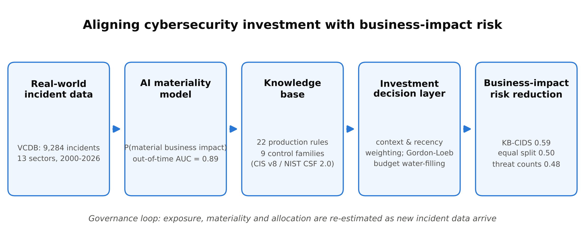

# Cybersecurity Investment and Business Performance (KB-CIDS)

Reproducible code for the manuscript **"Aligning cybersecurity investment with business-impact risk:
A knowledge-based AI decision-support model evaluated on real-world incident data"**
(Short Communication submitted to *Knowledge-Based Systems*, October 2026).

**Read the paper: [paper/Manuscript.pdf](paper/Manuscript.pdf)** · supplementary material:
[paper/Supplementary_Material.pdf](paper/Supplementary_Material.pdf) · all submission files: [paper/](paper)



KB-CIDS (Knowledge-Based Cybersecurity Investment Decision Support) asks a business question:
*where should the next unit of cybersecurity budget go so that it removes the most
business-impact risk?* It combines

1. a **knowledge base** of 22 production rules that maps VERIS threat patterns to nine control
   families aligned with CIS Controls v8 and NIST CSF 2.0, plus three expert consequence rules;
2. an **AI materiality model** (calibrated gradient boosting with knowledge features) that
   estimates the probability that an incident causes material business impact (operational
   disruption or exposure of at least 10,000 records);
3. a **decision layer** that weights historical incidents by firm context and recency and
   allocates a budget with the Gordon-Loeb class-I security-investment function
   (closed-form water-filling).

Everything is evaluated **out of time**: models are built on incidents up to 2016 and tested
on incidents from 2017 onwards.

## Highlights

- Knowledge base maps 9,284 real incidents to nine cybersecurity control families
- Knowledge features lift out-of-time material-impact prediction to AUC 0.891
- Threat-count budgeting underperforms an equal split on business-impact risk
- KB-CIDS beats equal and threat-count budgets in all 18 sector-size profiles
- Impact alignment and recency drive gains; imputing unknown impacts does not

## Repository layout

```
run_experiment.py            single entry point: regenerates every table and figure
requirements.txt
src/
  data_loader.py             pinned VCDB download + SHA-256 check + flattening
  preprocessing.py           cohort rules, business-impact label, feature engineering
  decision_intelligence.py   knowledge base, consequence rules, Gordon-Loeb allocation
  models.py                  materiality models (baselines and KB-CIDS)
  evaluation.py              metrics, bootstrap CIs, paired tests, decision evaluation
  explainability.py          permutation importance, allocation rationale, figures
results/
  tables/                    Table_1, Table_2 and supplementary tables S1-S9 (CSV)
  figures/                   Figure_1, Figure_2, Graphical_abstract (PNG 600 dpi + PDF)
  summary.json               every number quoted in the manuscript
  environment.json           library versions used for the reported run
paper/
  Manuscript.pdf / .docx     the manuscript as submitted
  Supplementary_Material.*   supplementary tables S1-S10
  Highlights.*               journal highlights
  submission/                cover letter and journal-compliance (readiness) report
  build/                     scripts that build the Word files from results/ and check every number
data/                        VCDB archive is downloaded here (not committed)
```

## Reproduce the results

```bash
python -m venv .venv
source .venv/bin/activate            # Windows: .venv\Scripts\activate
pip install -r requirements.txt
python run_experiment.py             # about 7-10 minutes on a laptop CPU
python run_experiment.py --quick     # fewer bootstrap draws, for a smoke test
```

The loader downloads `data/joined/vcdb.json.zip` from VCDB commit
`f6f98c00f66ab35f5b49977a5852ce94a5bb31d1` and verifies its SHA-256
(`e4be5dd4...c32c0`). If your network blocks the download, fetch that file from the commit
manually and place it at `data/vcdb.json.zip`. All random seeds are fixed (42).

## Outputs and where they appear in the manuscript

| Manuscript item | File |
|---|---|
| Table 1 - out-of-time materiality prediction | `results/tables/Table_1_predictive_validity.csv` |
| Table 2 - investment-decision performance | `results/tables/Table_2_decision_performance.csv` |
| Figure 1 - budget allocations vs realized risk | `results/figures/Figure_1.png` / `.pdf` |
| Figure 2 - budget curves and paired profile results | `results/figures/Figure_2.png` / `.pdf` |
| Graphical abstract | `results/figures/Graphical_abstract.png` / `.pdf` |
| S1 knowledge base and control families | `S1_knowledge_base.csv`, `S1b_control_families.csv` |
| S2 per-profile scores | `S2_profile_scores.csv` |
| S3 inner-validation tuning log | `S3_validation_tuning.csv` |
| S4 budget curve | `S4_budget_curve.csv` |
| S5 alpha/beta sensitivity | `S5_sensitivity_alpha_beta.csv` |
| S6 robustness specifications | `S6_robustness.csv` |
| S7 permutation importance | `S7_permutation_importance.csv` |
| S8 allocation rationale (example profile) | `S8_allocation_rationale_healthcare_small.csv` |
| S9 allocations by profile | `S9_allocations.csv` |

## Main results (reference budget, 18 sector-size profiles, 2017-2026)

| Strategy | Business-impact risk reduction (BIRR) |
|---|---|
| Equal allocation (undifferentiated spending) | 0.500 |
| Threat-frequency allocation | 0.483 |
| Impact-aligned allocation, pooled | 0.553 |
| **KB-CIDS** | **0.588** (better than equal and threat-frequency allocation in 18/18 profiles) |
| Oracle (ex post upper bound) | 0.656 |

The materiality model reaches out-of-time ROC-AUC 0.891 (95% CI 0.873-0.911). An ablation shows
that AI imputation of incidents with unknown impact magnitude did not improve out-of-time
allocation (0.599 without it); the manuscript reports and discusses this openly.

## Data, licences and citation

* Data: VERIS Community Database (VCDB), Verizon RISK Team, https://github.com/vz-risk/VCDB,
  licensed CC BY-SA 4.0. Derived tables in `results/` are shared under the same licence.
* Code: MIT License (see `LICENSE`).
* Please cite the manuscript once published; until then cite this repository:

```bibtex
@misc{nandagiri2026kbcids,
  author       = {Nandagiri, Rahul Chandra},
  title        = {Aligning cybersecurity investment with business-impact risk: A knowledge-based
                  {AI} decision-support model evaluated on real-world incident data},
  year         = {2026},
  note         = {Short Communication submitted to Knowledge-Based Systems},
  howpublished = {\url{https://github.com/rahulchandranandagiri/cybersecurity-investment-business-performance}}
}
```
